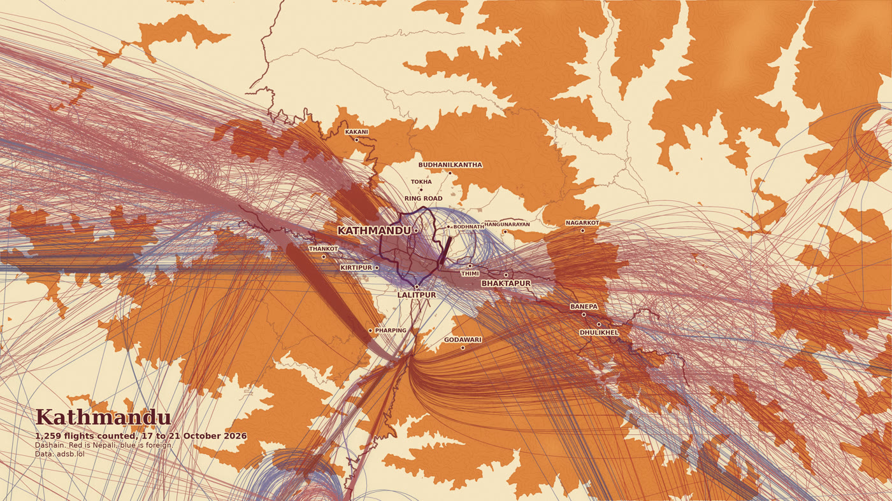
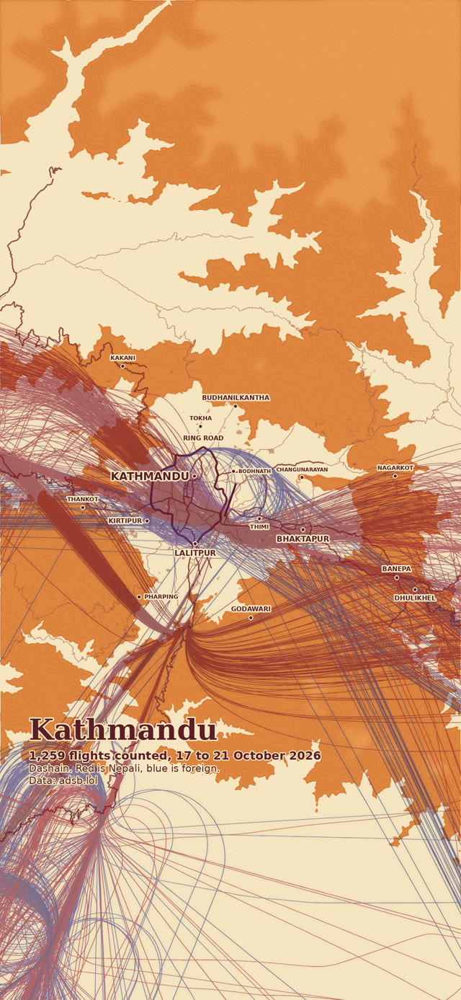
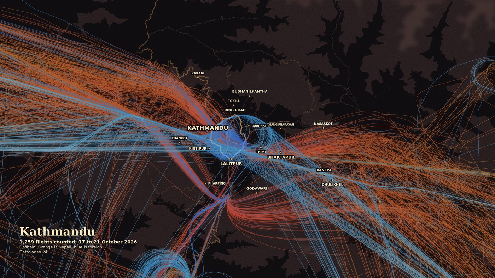
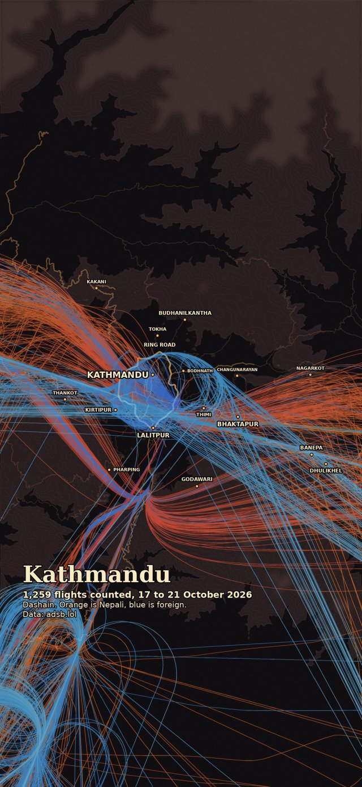
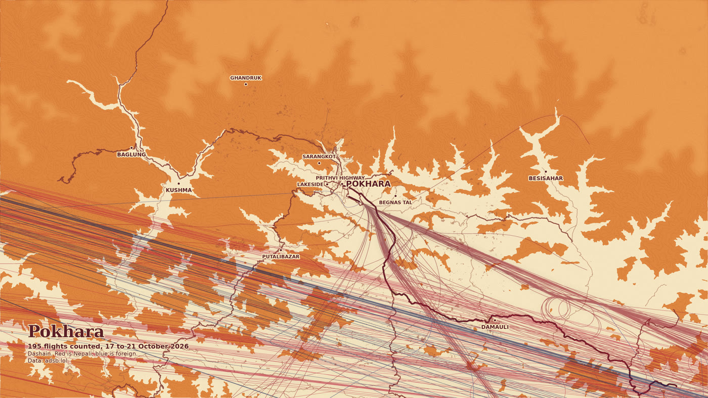
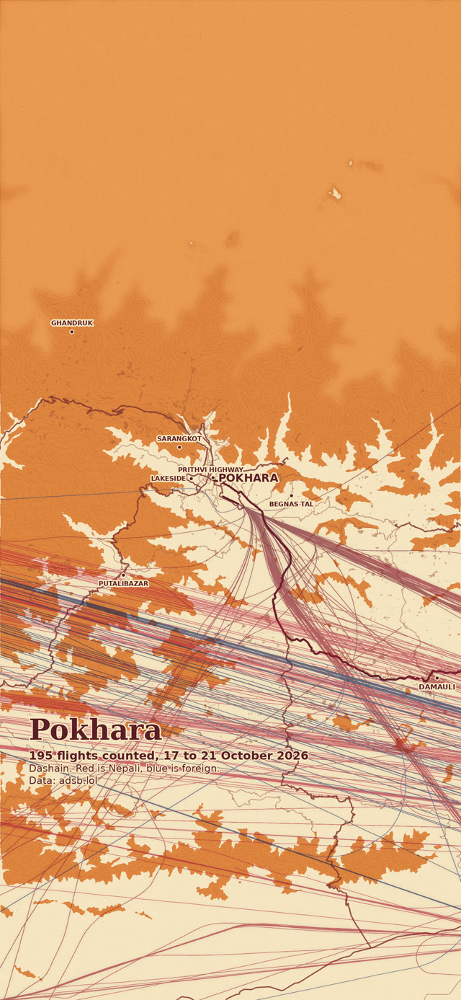
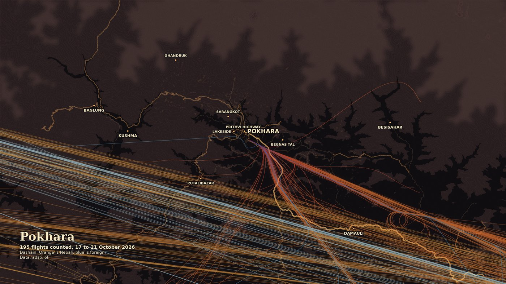
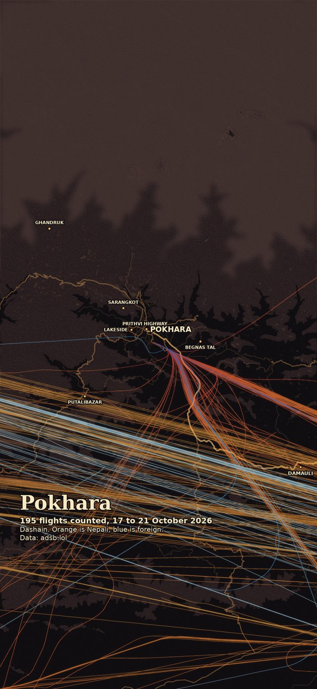

Five Dashain days of flights on one map, as wallpapers for your phone and your desktop, in a light and a dark version. Each line is one flight over Kathmandu or Pokhara, from Fulpati on 17 October to Vijaya Dashami on 21 October 2026.

## Download

### Kathmandu



- [Desktop, 3840 x 2160 (JPG, 5.9 MB)](/assets/wallpapers/kathmandu-dashain-2026-desktop.jpg)
- [Phone, 1440 x 3120 (JPG, 2.7 MB)](/assets/wallpapers/kathmandu-dashain-2026-phone.jpg)



**Dark version**



- [Dark desktop, 3840 x 2160 (JPG, 3.7 MB)](/assets/wallpapers/kathmandu-dashain-2026-desktop-dark.jpg)
- [Dark phone, 1440 x 3120 (JPG, 1.7 MB)](/assets/wallpapers/kathmandu-dashain-2026-phone-dark.jpg)



1,259 flights counted at Tribhuvan International Airport. Fulpati was the busiest day with 278.

### Pokhara



- [Desktop, 3840 x 2160 (JPG, 4.9 MB)](/assets/wallpapers/pokhara-dashain-2026-desktop.jpg)
- [Phone, 1440 x 3120 (JPG, 2.5 MB)](/assets/wallpapers/pokhara-dashain-2026-phone.jpg)



**Dark version**



- [Dark desktop, 3840 x 2160 (JPG, 3.0 MB)](/assets/wallpapers/pokhara-dashain-2026-desktop-dark.jpg)
- [Dark phone, 1440 x 3120 (JPG, 1.6 MB)](/assets/wallpapers/pokhara-dashain-2026-phone-dark.jpg)



195 flights counted at Pokhara International Airport, about 39 a day.

## How to read it

Red lines are Nepali (domestic) flights. Blue lines are foreign (international) flights. Darker means lower, lighter means higher. The thick bundles are the approach and departure paths in and out of the valley. The orange ground is hills and the cream ground is the valley floor.

The dark versions use the same data on a charcoal map. Orange and red lines are Nepali flights, blue lines are foreign flights, and lighter means higher.

## Set it as your wallpaper

- **iPhone:** open the image in Photos, tap Share, then Use as Wallpaper.
- **Android:** open the image in your gallery, open the menu, then Set as wallpaper.
- **Windows:** right-click the image, then Set as desktop background.
- **macOS:** right-click the image in Finder, then Set Desktop Picture.

## Where the data comes from

- **Flights:** [adsb.lol](https://www.adsb.lol/), a community network of ADS-B receivers. ADS-B is the position signal most aircraft broadcast every second or so. adsb.lol publishes each day as open data in its [globe history](https://github.com/adsblol/globe_history) archive.
- **Roads, towns and runways:** [OpenStreetMap](https://www.openstreetmap.org/), downloaded through the Overpass API.
- **Terrain:** the [AWS terrain tiles](https://registry.opendata.aws/terrain-tiles/) elevation dataset, shaded into the hills.
- **Dashain dates:** the Nepal government holiday list. Fulpati was 17 October, Maha Ashtami 18 and 19 October, Maha Navami 20 October and Vijaya Dashami 21 October.

## How the flights were counted

For each of the five days I took the final published adsb.lol file. The site posts a first version right after midnight UTC and a complete one a few hours later, and the first version is incomplete, so I only used the complete one. Nepal is UTC+5:45, so the day starts at 5:45 AM local time on the clock.

Flights that only pass over the area far from the airport are left out, and so are helicopters. Domestic means a Nepal-registered aircraft (registrations starting with 9N) that is not a wide-body. Everything else is foreign.

Arrivals and departures are counted at the runway. The five days were checked by downloading them a second time and comparing with the first copy, and 17, 18 and 20 October were identical.

## Limits

- Receivers on the ground lose low aircraft in the Kathmandu valley, because the hills block the signal. The last kilometres before touchdown and the take-off roll are modelled from the runway position, so those parts are an estimate, not a recording.
- Only aircraft that carry a working ADS-B transmitter and are heard by a receiver appear. The counts are a lower bound.
- Pokhara's one international arrival and one departure a day are flydubai flights from Dubai, which started on 23 September 2026.

## Use and credit

The wallpapers are open licensed under [Creative Commons Attribution 4.0 (CC BY 4.0)](https://creativecommons.org/licenses/by/4.0/). You can use, share, print and adapt them, including commercially, as long as you give credit and link to this page.

The images contain data from three sources, and each has its own credit rule. Keep all of them when you share a wallpaper.

- **This wallpaper:** Nishon Tandukar, [CC BY 4.0](https://creativecommons.org/licenses/by/4.0/), with a link to this page. Say if you changed it.
- **Flights:** data from [adsb.lol](https://www.adsb.lol/) and its feeders, published under the [Open Database License (ODbL) 1.0](https://opendatacommons.org/licenses/odbl/1-0/). Credit adsb.lol and say the data is under the ODbL.
- **Map:** © [OpenStreetMap contributors](https://www.openstreetmap.org/copyright), ODbL 1.0. Credit OpenStreetMap and make clear the data is under the ODbL. In print, write out the address openstreetmap.org/copyright.
- **Terrain:** SRTM and GMTED2010 elevation data courtesy of the U.S. Geological Survey, served as [AWS Terrain Tiles](https://registry.opendata.aws/terrain-tiles/).

Copy and paste credit:

```text
Nishon Tandukar (nishon.com.np/dashain-flights-wallpapers). Flight data © adsb.lol and its feeders, ODbL 1.0. Map data © OpenStreetMap contributors, ODbL 1.0 (openstreetmap.org/copyright). Terrain: SRTM and GMTED2010 data courtesy of the U.S. Geological Survey, via AWS Terrain Tiles.
```

The fonts in the images, Yatra One and Mukta, are under the SIL Open Font License, which asks for no credit on pictures.

I also post these maps as videos, one for each Dashain day, plus a comparison with an ordinary Wednesday in September. Find them on [Instagram at @life.of.nishon](https://www.instagram.com/life.of.nishon/).
